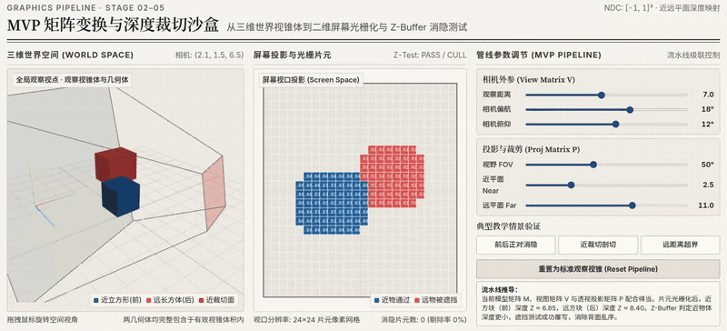
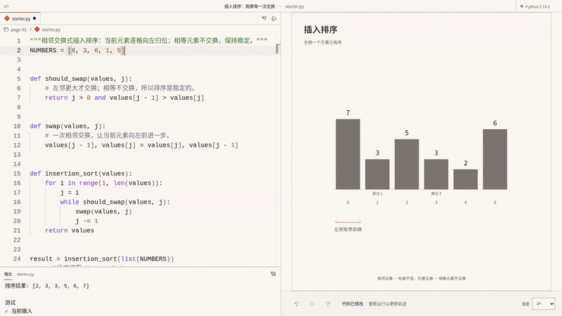
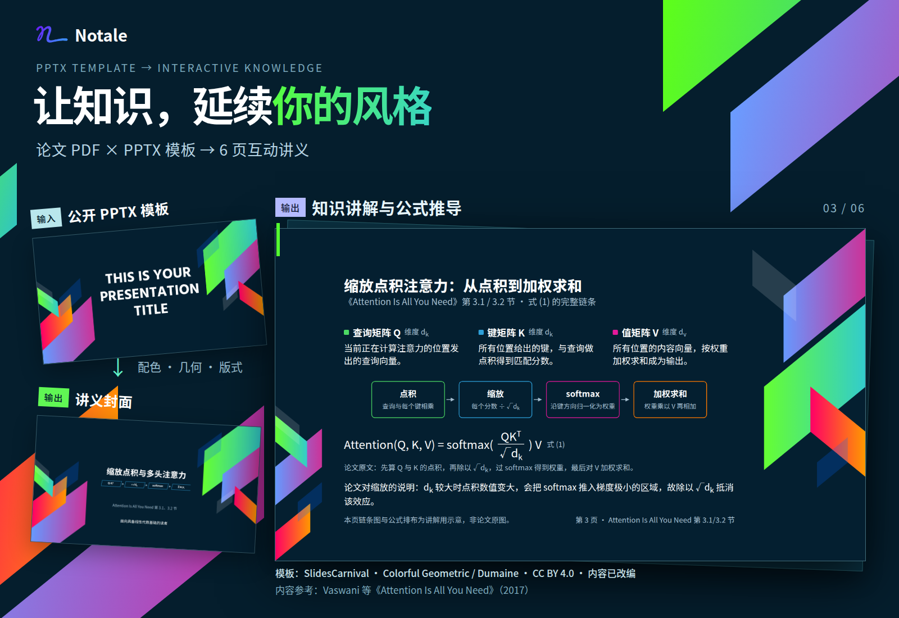
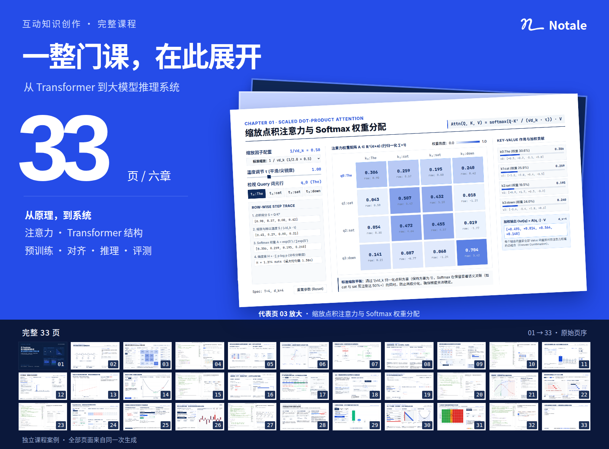
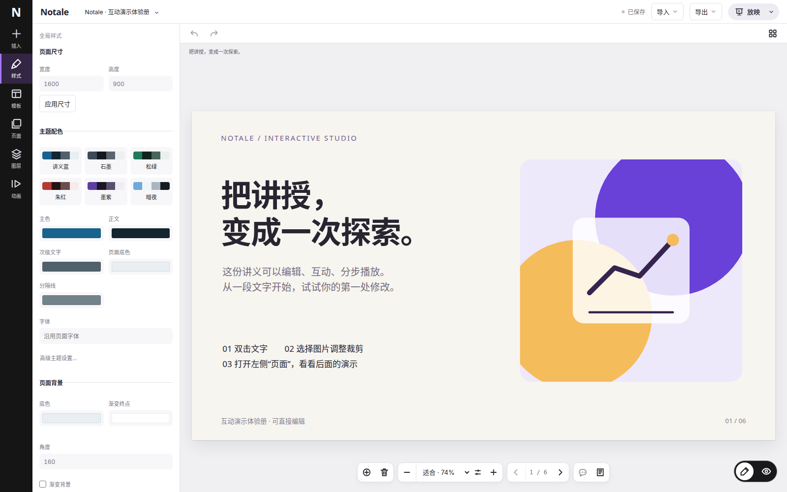

<p align="center">
  <picture>
    <source media="(prefers-color-scheme: dark)" srcset="docs/assets/readme/notale-lockup-dark.svg">
    
  </picture>
</p>

<h1 align="center">重塑知识的创作与学习方式</h1>

<p align="center">AI 原生互动知识创作平台</p>

<p align="center">
  <a href="https://github.com/THU-AICosmos/Notale/actions/workflows/ci.yml"></a>
  <a href="CHANGELOG.md"></a>
  <a href="docs/DOCKER.zh-CN.md"></a>
  <a href="notale-editor/tsconfig.json"></a>
  <a href="LICENSE"></a>
</p>

<p align="center"><a href="README.md">English</a> · <strong>简体中文</strong></p>

<p align="center"><a href="https://aicosmos.ai">在线体验</a> · <a href="#快速开始">快速开始</a> · <a href="#让知识在眼前绽放">真实案例</a> · <a href="#项目架构">项目架构</a></p>


知识可以成为每个人都能亲自参与的体验。系统的讲解帮助我们建立认识，动手实验则让我们改变条件、观察反馈、验证理解。Notale 将这些过程组织在同一套知识叙事中。

用自然语言描述你想讲授、分享或理解的主题，按需上传论文、参考材料和 PPTX 模板。Notale 将它们转化为集知识讲解、动态可视与真实操作于一体的互动讲义。生成后，还可以通过对话和可视化编辑持续打磨，再用于演示，或导出为 HTML 带走。

由**清华大学 CoAI 实验室 AI Cosmos 团队**打造，Notale 希望降低互动知识内容的创作门槛，让创作者专注于知识本身，让学习者从被动接收走向主动探索。

## 快速开始

使用 **Docker 和 Docker Compose** 启动自己的个人工作空间。Node.js、PostgreSQL 和浏览器依赖均在容器中运行，无需在宿主机另外安装。

**1. 获取代码，创建配置文件。**

```bash
git clone https://github.com/THU-AICosmos/Notale.git
cd Notale
cp .env.example .env.local
```

**2. 打开 `.env.local`，填写 `GEMINI_API_KEY` 和 `PARATERA_API_KEY`。** 两者分别是所用模型服务商的凭据，模型调用使用你自己的服务商账户。

**3. 一行命令启动。**

```bash
docker compose --env-file .env.local up -d --build --wait
```

打开 **[localhost:3000](http://localhost:3000)** 开始创作。可视化编辑器位于 **[localhost:4312](http://localhost:4312)**；也可在生成结果中选择“在编辑器中打开”，继续修改这份讲义。首次启动需要构建应用、下载依赖，耗时会比后续启动更长。

停止服务并保留数据：

```bash
docker compose --env-file .env.local down
```

配置、日志、更新、数据存储与故障排查见 **[Docker 部署指南](docs/DOCKER.zh-CN.md)**。

> [!IMPORTANT]
> 这套配置是绑定本机访问的个人工作空间。若要向其他用户开放服务，请按照[集成指南](notale-editor/docs/INTEGRATION.md)接入身份认证与权限控制，并为讲义内容设置独立来源。

## 让知识在眼前绽放

### 让抽象原理变得可感知

移动相机，调整视野或裁剪平面，三维场景与二维投影便会同步变化。读者能够亲手改变条件，理解公式如何影响眼前的世界。



### 让真实计算成为讲解的一部分

修改 Python 数组，运行代码。插入排序工作台将代码、执行记录与动态柱状图放在同一页面，动画随**浏览器中真实的 Python 执行结果**展开。



*演示来自内置的插入排序 sample。录制时实际修改输入并运行代码，执行结果由程序计算产生。*

### 带上你的材料，延续你的风格

论文提供内容依据，PPTX 模板提供视觉参考。在这个案例中，用户上传《Attention Is All You Need》与公开演示模板，生成了一套**六页注意力机制讲义**，包含知识讲解与互动实验。



*模板：SlidesCarnival，Colorful Geometric / Dumaine，CC BY 4.0，内容已改编。详见[素材来源](docs/assets/readme/SOURCES.md)。*

### 把互动组织成完整的学习历程

Notale 将互动活动融入有结构的知识讲解。下面是**另一个独立案例**：从六章大纲出发，生成一套 **33 页课程**，涵盖 Transformer、注意力机制、缩放定律、后训练与推理系统。



*这套课程来自独立的大纲任务，与上方的论文、模板案例分别生成。*

## 从第一稿，继续创作

1. **创作。** 描述主题，附上材料，在 Viewer 中查看生成过程。
2. **探索。** 改变输入、操作可视模型、运行受支持的代码实验。
3. **打磨。** 对话修改或进入可视化编辑器，调整内容、页面、步骤与备注。
4. **演示与保存。** 使用讲者工具和观众窗口演示，导出 HTML 或 `.notale` 工程。



完成的对话修改会形成新版本；再次打开同一版本，会保留已保存的手工编辑。你也可以直接进入编辑器，不经过 AI 生成，从头创作讲义。

自定义脚本和 Canvas 内容需要相应适配器才能进行可视化编辑，当前范围见[集成覆盖说明](notale-editor-frontend/docs/INTEGRATION-COVERAGE.md)。

## 项目架构

| 项目 | 职责 |
| --- | --- |
| [`notale-ts/`](notale-ts/) | AI 生成、对话修改、命令行与 HTTP/SSE 服务 |
| [`notale-viewer/`](notale-viewer/) | 讲义库、创作对话、生成进度与预览 |
| [`notale-editor-frontend/`](notale-editor-frontend/) | 可视化编辑与演示工作区 |
| [`notale-editor/`](notale-editor/) | 文档模型、HTTP API、修订存储与页面运行时 |
| [`notale-format/`](notale-format/) | 共享的 `.notale` 归档与页面运行时格式 |

生成器输出在浏览器中运行的讲义页面，Viewer 展示生成过程，并将选中的结果打开到编辑器。PostgreSQL 保存编辑器文档与资源，讲义内容由独立来源提供。

源码开发需要 **Node.js 20.19+**，按对应项目的指南配置即可。上方 Docker 方式会准备完整的本地运行环境。

| 继续了解 | 文档入口 |
| --- | --- |
| 运行和维护个人工作空间 | [Docker 部署指南](docs/DOCKER.zh-CN.md) |
| 配置生成器与模型服务 | [生成器指南](notale-ts/README.md) · [Viewer 指南](notale-viewer/README.md) |
| 开发编辑器 | [前端指南](notale-editor-frontend/README.md) · [架构说明](notale-editor-frontend/docs/EDITOR-ARCHITECTURE.md) |
| 准备演示 | [讲授指南](notale-editor-frontend/docs/PRESENTATION.md) · [页面模板](notale-editor-frontend/templates/original/README.md) |
| 将 Notale 接入自己的产品 | [集成指南](notale-editor/docs/INTEGRATION.md) |

欢迎提交可复现的问题、新案例，以及让创作体验更好的改进。较大的改动建议先通过 issue 描述预期流程；修改文档时，请保持中英文 README 同步。

Notale 自有源码采用 [Apache 2.0 许可证](LICENSE)。第三方资源保留各自的许可证与声明，详见[资源声明](notale-ts/RESOURCE-AUDIT.md)和 [README 素材来源](docs/assets/readme/SOURCES.md)。
